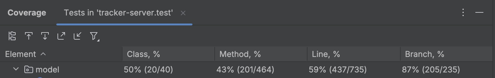

# Traccar, project group 3

- Baseline commit: `19b951f`
- Final commit: `9777989`

## Evidence

## Run the tests and measure coverage

**Requirements**: JDK21, Intellij IDEA. Project imported as a Gradle project.

1. Right-click the package `src.test`  -> More Run/Debug -> Run 'Tests in 'tracker-server.test' with Coverage.
2. In the coverage window, expand the `model` package and read the branch column.

| Version  | Branch coverage (model package) |
|----------|---------------------------------|
| Baseline | 51%  (121/235)                  |
| Final    | 87% (205/235)                   |

5 tests should fail, 753 should pass, 23 are ignored.
